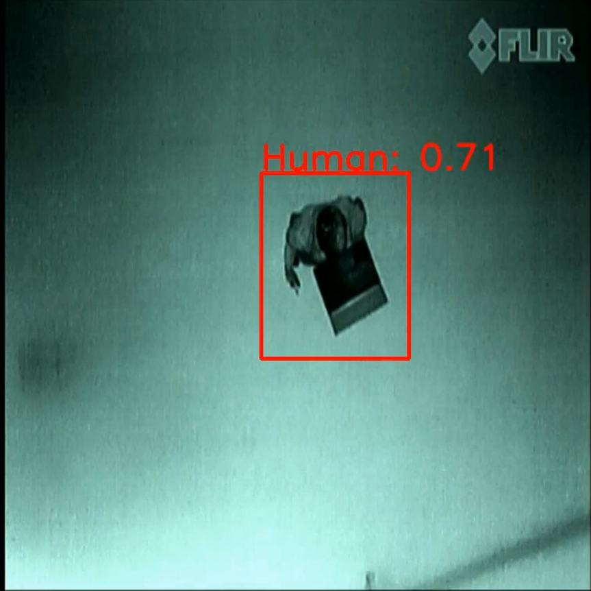

# Person Detection From Drone — Real-Time YOLOv5 Video Streaming

Real-time object detection on a live camera feed from a drone. A client on the drone side captures camera frames and sends them over the network to a ground server, which runs a custom-trained **YOLOv5** model and streams the annotated video back to a browser.



🎥 Demo video: [`media/person_Detection.mp4`](media/person_Detection.mp4)

## How it works

```text
Camera (drone side)
      ↓  OpenCV capture, resize to 1000×800, JPEG + base64
client_code.py  ──HTTP POST /receive_data_image──►  server_code.py (Flask)
                                                        ↓
                                              Custom YOLOv5 model (PyTorch)
                                                        ↓
                                   Bounding boxes + class labels + confidence
                                                        ↓
                                 MJPEG stream at  http://<server-ip>:8080/termal
```

- **`client_code.py`** captures frames with OpenCV, encodes them as JPEG/base64 and POSTs them to the server in a background thread.
- **`server_code.py`** is a Flask app that receives frames, runs YOLOv5 inference, draws labelled boxes, shows a **"DRONE DETECTED"** banner when the `drone` class appears, and streams the result as MJPEG.

## Tech stack

Python • OpenCV • PyTorch • YOLOv5 (custom weights) • Flask • HTTP / MJPEG streaming

## Run it

```bash
pip install flask opencv-python numpy requests torch ultralytics
```

1. In `server_code.py`, set the `path` in `torch.hub.load(...)` to your trained `best.pt` weights.
2. Start the server: `python server_code.py` (listens on port 8080).
3. In `client_code.py`, set `server_address` to the server machine's IP.
4. Start the client: `python client_code.py`
5. Open `http://<server-ip>:8080/termal` in a browser to see the detections.

## Author

**Jani Basha Shaik** — Robotics Engineer · [LinkedIn](https://www.linkedin.com/in/janibasha1801/)
